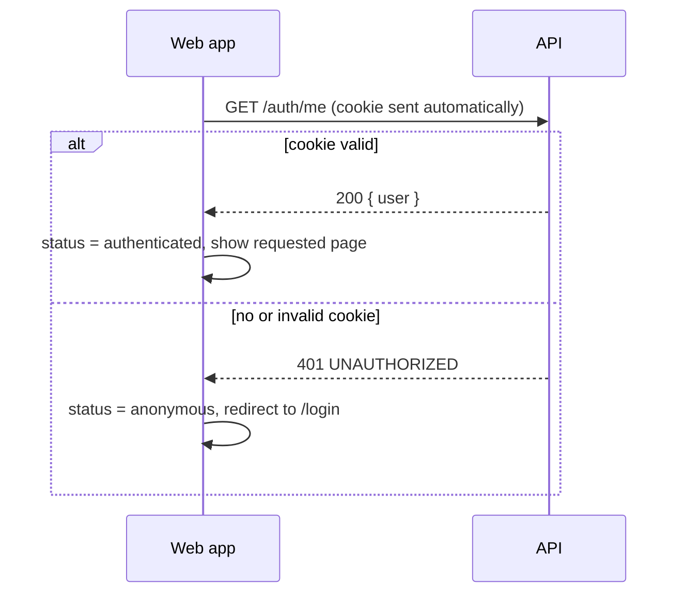
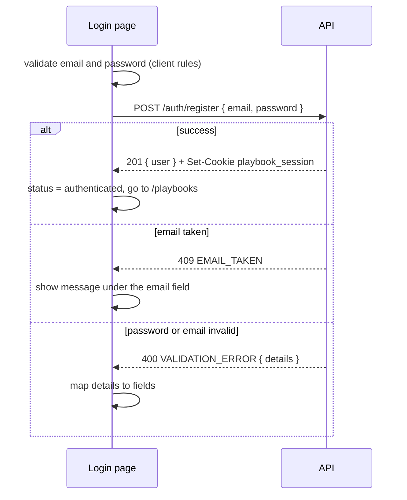
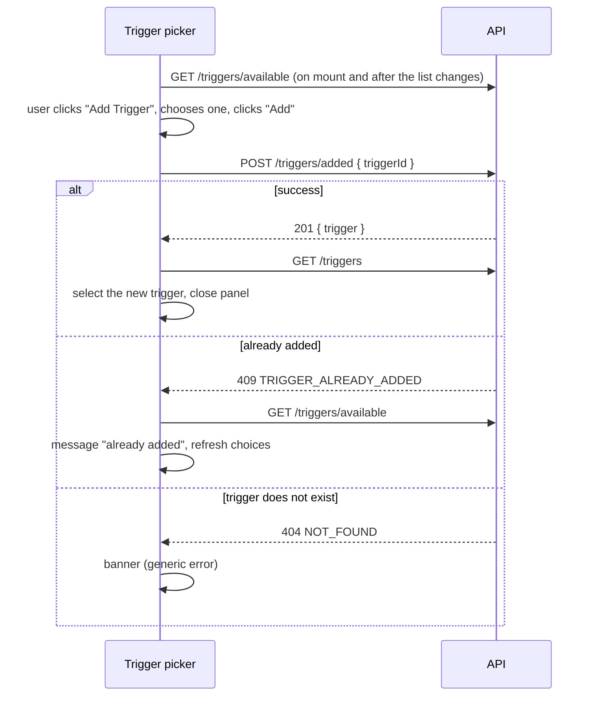
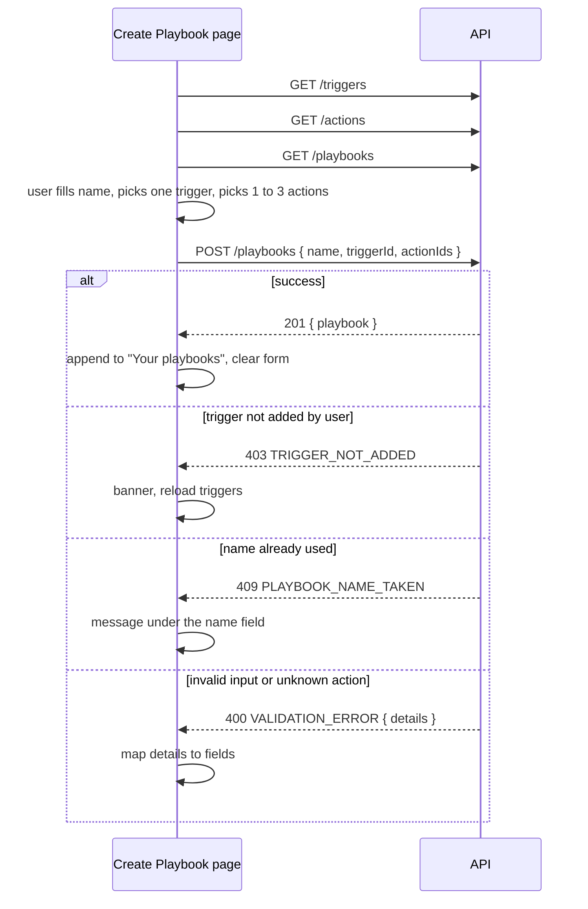
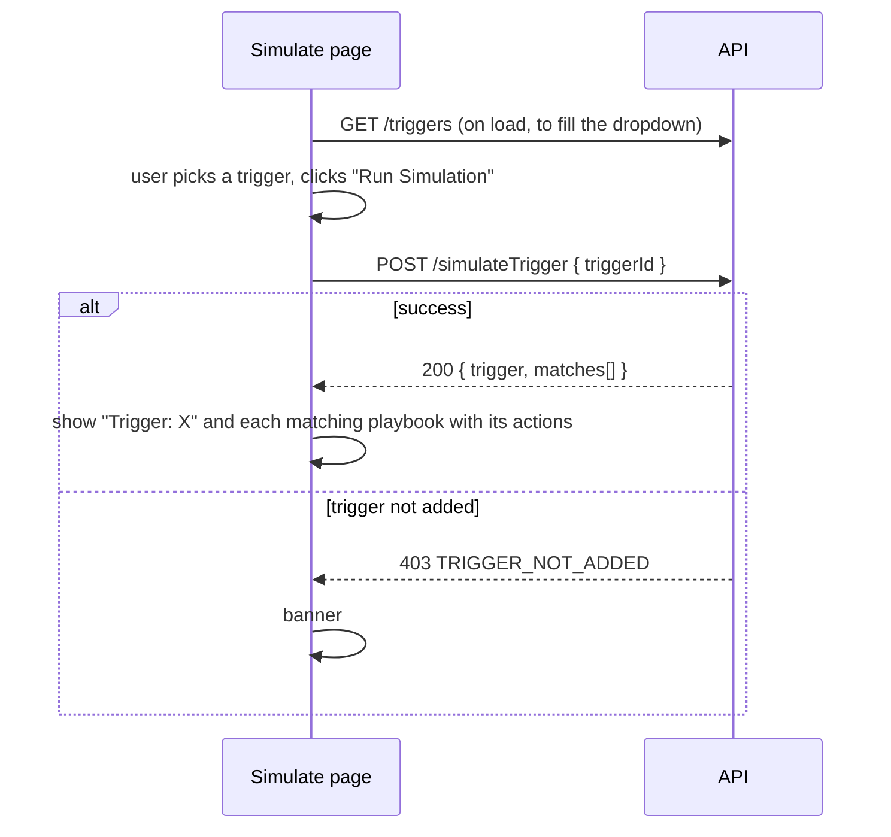

# Flows and Contracts

This document maps every user flow in the web app to the API calls it makes, and lists the request and response contract for each endpoint. The machine-readable spec is served at `/api/openapi.json` (Swagger UI at `/api/docs`). Keep this file and `server/src/docs/openapi.ts` in step.

Source references: UI in `client/src/pages/`, `client/src/auth/`, `client/src/components/TriggerPicker.tsx`; API client in `client/src/api/`; server routes in `server/src/routes/`.

## 1. Conventions

- **Base path.** The web app calls `/api/...`. nginx (production) and the Vite dev proxy both strip `/api`, so the server sees `/auth/...`, `/playbooks/...`, and so on.
- **Authentication.** The session is an HttpOnly cookie named `playbook_session`, valid for 24 hours, `SameSite=Strict`. The client never reads or stores a token.
- **Error shape.** Every error is `{ "error": { "code", "message", "details"? } }`. `details` is an array of `{ path, message }` and appears only on `VALIDATION_ERROR`.
- **Error codes.**

| Code | HTTP | Meaning |
|---|---|---|
| `VALIDATION_ERROR` | 400 | Body or params failed validation, or body is malformed JSON or too large |
| `UNAUTHORIZED` | 401 | No valid session cookie, or the user no longer exists |
| `INVALID_CREDENTIALS` | 401 | Wrong email or password on login |
| `TRIGGER_NOT_ADDED` | 403 | The trigger is not in the user's added list |
| `NOT_FOUND` | 404 | Trigger, playbook, or unknown route does not exist for this user |
| `EMAIL_TAKEN` | 409 | Email already registered |
| `TRIGGER_ALREADY_ADDED` | 409 | Trigger already in the user's list |
| `PLAYBOOK_NAME_TAKEN` | 409 | The user already has a playbook with this name (case-insensitive) |
| `INTERNAL` | 500 | Unexpected server error; details are logged server-side only |

- **Authorization rule.** Every route except `/auth/register`, `/auth/login`, `/auth/logout`, `/openapi.json` and `/docs` requires a valid session. Users see only their own triggers and playbooks. A playbook owned by another user returns `404`, not `403`.

## 2. Screens and routes

| Route | Screen | Access | Purpose |
|---|---|---|---|
| `/login` | Login / Register | Public | Sign in or create an account |
| `/playbooks` | Create Playbook | Signed in | Add triggers, create and delete playbooks |
| `/simulate` | Simulate Event | Signed in | Run a trigger and see which playbooks match |
| `*`, `/` | — | — | Redirect to `/playbooks` |

The signed-in screens share a layout with a top bar (user email), a side nav (Create Playbook, Simulate Event, Logout), and a route guard (`RequireAuth`).

## 3. Flows

### 3.1 Session restore (every page load)

The app starts in `loading` and checks the cookie once.



Note: a 401 from `/auth/me` does not trigger the "session expired" message. Only 401s from other endpoints do.

### 3.2 Register



### 3.3 Login and logout

- **Login:** `POST /auth/login`. Success returns `200 { user }` and sets the cookie. Failure returns `401 INVALID_CREDENTIALS`, shown as a banner. The message never says whether the email exists.
- **Logout:** the Logout button calls `POST /auth/logout` (returns `204` and clears the cookie). The client clears local state and goes to `/login` even if the request fails.

### 3.4 Session expired

Any `401` from a non-auth endpoint, for example `GET /playbooks` while the cookie has expired, runs the unauthorized handler. The client clears the user, navigates to `/login`, and shows "session expired".

### 3.5 Add a trigger (inside Create Playbook)

The trigger picker lists the user's added triggers and, when opened, the ones they can still add.



Triggers can be added but never removed. The list is append-only.

### 3.6 Create a playbook

On load, the page makes three calls in parallel.



Rules the client enforces before sending (mirroring the server): name 1 to 100 characters after trim, one trigger, 1 to 3 distinct actions. Actions are sent in catalogue order, and that order is stored as the playbook's order.

### 3.7 Delete a playbook

1. The user clicks Delete on a row and confirms in the browser dialog.
2. `DELETE /playbooks/{id}`.
3. `204`: the row is removed from the list. Any error shows a banner. A `404` (not found or owned by someone else) shows the server message.

### 3.8 Simulate an event



An empty `matches` array shows "no matching playbooks". The simulation only reads data. It executes nothing.

### 3.9 Public documentation

`GET /openapi.json` and `GET /docs` need no session. They are for developers and do not appear in the web app.

## 4. Endpoint contracts

All request bodies are JSON with `Content-Type: application/json`. Body size limit: 10 KB.

### 4.1 Auth

| Method | Path | Auth | Request | Success | Errors |
|---|---|---|---|---|---|
| POST | `/auth/register` | none | `{ email, password }` | `201 { user }` + cookie | 400, 409 `EMAIL_TAKEN` |
| POST | `/auth/login` | none | `{ email, password }` | `200 { user }` + cookie | 400, 401 `INVALID_CREDENTIALS` |
| POST | `/auth/logout` | none | — | `204`, cookie cleared | — |
| GET | `/auth/me` | cookie | — | `200 { user }` | 401 |

Field rules:

- `email`: trimmed, lower-cased, a valid email, at most 255 characters.
- `password` on register: 8 or more characters, at most 72 bytes, at least one letter and one digit.
- `password` on login: at least 1 character. A password over 72 bytes is rejected as `INVALID_CREDENTIALS`.

`user` is `{ "id": uuid, "email": string }`. The token is never in a response body.

### 4.2 Triggers

| Method | Path | Auth | Request | Success | Errors |
|---|---|---|---|---|---|
| GET | `/triggers` | cookie | — | `200 { triggers: Trigger[] }` | 401 |
| GET | `/triggers/available` | cookie | — | `200 { triggers: Trigger[] }` | 401 |
| POST | `/triggers/added` | cookie | `{ triggerId: uuid }` | `201 { trigger }` | 400, 401, 404, 409 `TRIGGER_ALREADY_ADDED` |

`Trigger` is `{ "id": uuid, "name": string }`. `/triggers` is the user's added list. `/triggers/available` is the catalogue minus that list.

### 4.3 Actions

| Method | Path | Auth | Success | Errors |
|---|---|---|---|---|
| GET | `/actions` | cookie | `200 { actions: Action[] }` | 401 |

`Action` is `{ "id": uuid, "name": string }`. The catalogue is seeded and read-only.

### 4.4 Playbooks

| Method | Path | Auth | Request | Success | Errors |
|---|---|---|---|---|---|
| GET | `/playbooks` | cookie | — | `200 { playbooks: Playbook[] }` | 401 |
| POST | `/playbooks` | cookie | `{ name, triggerId, actionIds }` | `201 { playbook }` | 400, 401, 403 `TRIGGER_NOT_ADDED`, 409 `PLAYBOOK_NAME_TAKEN` |
| DELETE | `/playbooks/{id}` | cookie | — | `204` | 401, 404 |

Request rules for `POST /playbooks`:

- `name`: 1 to 100 characters after trim. Unique per user, ignoring letter case.
- `triggerId`: UUID, must be in the user's added list.
- `actionIds`: 1 to 3 UUIDs, no duplicates, every id must exist in the catalogue. The order given is the stored order.

`Playbook` is:

```json
{
  "id": "uuid",
  "name": "string",
  "trigger": { "id": "uuid", "name": "string" },
  "actions": [{ "id": "uuid", "name": "string" }],
  "createdAt": "ISO-8601 timestamp"
}
```

An unknown action id returns `400 VALIDATION_ERROR` with `details[0].path = "actionIds"`.

### 4.5 Simulation

| Method | Path | Auth | Request | Success | Errors |
|---|---|---|---|---|---|
| POST | `/simulateTrigger` | cookie | `{ triggerId: uuid }` | `200 SimulationResult` | 400, 401, 403 `TRIGGER_NOT_ADDED`, 404 |

```json
{
  "trigger": { "id": "uuid", "name": "string" },
  "matches": [
    {
      "playbook": { "id": "uuid", "name": "string" },
      "actions": [{ "id": "uuid", "name": "string" }]
    }
  ]
}
```

`matches` lists only the user's own playbooks that use this trigger. It is empty when there are none.

### 4.6 Public documentation

| Method | Path | Response |
|---|---|---|
| GET | `/openapi.json` | OpenAPI 3.0 document (JSON) |
| GET | `/docs` | Swagger UI page (HTML) |

## 5. Endpoint-to-screen map

| Endpoint | Login | Create Playbook | Simulate Event | Session restore / logout |
|---|---|---|---|---|
| `POST /auth/register` | ✔ | | | |
| `POST /auth/login` | ✔ | | | |
| `POST /auth/logout` | | | | ✔ (Logout button) |
| `GET /auth/me` | | | | ✔ (every load) |
| `GET /triggers` | | ✔ (load, after add) | ✔ (load) | |
| `GET /triggers/available` | | ✔ (picker mount, after change) | | |
| `POST /triggers/added` | | ✔ (Add) | | |
| `GET /actions` | | ✔ (load) | | |
| `GET /playbooks` | | ✔ (load) | | |
| `POST /playbooks` | | ✔ (Create) | | |
| `DELETE /playbooks/{id}` | | ✔ (Delete) | | |
| `POST /simulateTrigger` | | | ✔ (Run) | |

## 6. Known gaps

- **No trigger removal.** The API has no endpoint to remove a trigger from the added list, so a user cannot undo an add.
- **No playbook edit.** Playbooks can only be created and deleted.
- **Stale list after delete.** Deleting a playbook in one tab does not refresh another open tab. Reload to see the change.
- **Simulation reads only.** `POST /simulateTrigger` reports matches and never executes actions.
