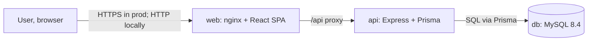

# High-Level Design — Security Automation Playbook Builder

Date: 2026-11-22
Status: Draft for implementation
Related: `docs/superpowers/specs/2026-11-17-playbook-builder-design.md` (detailed design), `requirements.docx` (source requirements)

## 1. Purpose

A small full-stack web app. A user signs in, creates security automation playbooks (a name, one trigger, and 1–3 actions), and simulates an incoming event to see which of their playbooks match and which actions would run. Triggers and actions are predefined data. Each user sees only their own playbooks and only the triggers they have added.

This is a take-home exercise. It must be easy to read, easy to run, and cover the evaluation criteria: structure, REST integration, separation of concerns, error handling, tests, and documentation.

## 2. Scope

In scope:
- Email/password registration and login. The session is a JWT in an HttpOnly cookie.
- Create, list and delete playbooks.
- Add triggers from a predefined list; manage the user's trigger list.
- Simulate an event for a trigger.
- Three UI pages: Login/Register, Create Playbook, Simulate Event.
- One-command local run with Docker Compose.

Out of scope:
- Editing playbooks, creating or deleting triggers and actions, executing real actions.
- Password reset, email verification, OAuth, roles, playbook sharing, token refresh, login lockout.
- Production hardening (HTTPS termination, secrets manager).
- Splitting the backend into microservices (see D10).

## 3. Context



The user talks only to the web container. The API and database are internal to the Compose network.

## 4. Containers

| Container | Technology | Responsibility | Exposed |
|---|---|---|---|
| `web` | React SPA (Vite build) served by nginx | UI, client-side routing, session check on load, proxy `/api` to `api` | host port 8080 |
| `api` | Node.js, TypeScript, Express, Prisma | REST API, authentication, authorisation, business rules, simulation | internal port 4000 |
| `db` | MySQL 8.4 | Users, triggers, actions, user trigger lists, playbooks | internal port 3306; named volume `db_data` |

Startup order: `db` (healthcheck) → `api` (runs `prisma migrate deploy`, which includes the seed, then starts) → `web`.

## 5. Backend structure

Layered, one responsibility per layer:

```
HTTP request
   → middleware (authenticate, error handling)
   → routes (HTTP mapping, Zod validation)
   → services (business rules)
   → repositories (Prisma queries; every playbook query is scoped by userId)
   → MySQL
```

Cross-cutting pieces:
- `config` — reads environment variables and fails fast when one is missing.
- `errors` — `AppError` subclasses mapped to a single JSON error shape by the error handler.

## 6. Frontend structure

```
pages  →  api (apiClient + resource modules)  →  REST
  ↑
auth (AuthProvider, RequireAuth)
components (NavBar, TriggerPicker, ErrorBanner)
```

- Three pages map one-to-one to the requirements.
- `apiClient` is the single place that sends requests (same-origin, so the browser attaches the session cookie), converts errors, and handles 401 on protected calls (end the session, go to login).
- Shared components are reused across Create Playbook and Simulate Event (trigger selection).

## 7. Key flows

**Registration and login.** The client posts credentials to `/auth/register` or `/auth/login`. The API validates input, hashes the password with bcrypt, and returns a JWT with the user's id as `sub`, set in an HttpOnly cookie named `playbook_session`. The response body carries only the user. On load, the client calls `GET /auth/me` to learn whether the cookie is still valid.

**Authenticated request.** Each protected request carries the session cookie, which the browser sends automatically. The API verifies the signature and expiry, loads the user from the database, and checks any trigger grant against the `UserTrigger` table. A missing or invalid session, or a user who no longer exists, returns 401.

**Add a trigger.** The user opens Add Trigger, which lists predefined triggers not yet added. Choosing one creates a `UserTrigger` row. The trigger then appears in the user's selects.

**Create a playbook.** The client sends name, trigger and 1–3 action ids. The API checks the trigger is in the user's list, the actions exist, and the name is unique for that user. It stores the playbook with actions in the order sent.

**Simulate an event.** The client sends a trigger id. The API checks the trigger is in the user's list, then returns the caller's playbooks that use that trigger, each with its actions in stored order. Other users' playbooks are never considered.

## 8. Data

Six tables, all in MySQL, managed by Prisma migrations:

| Table | Purpose | Owner |
|---|---|---|
| `User` | Account (email, password hash) | — |
| `Trigger` | Predefined triggers | seeded |
| `Action` | Predefined actions, with display order | seeded |
| `UserTrigger` | Triggers a user has added | per user |
| `Playbook` | A user's playbook; unique name per user | per user |
| `PlaybookAction` | Ordered actions of a playbook | per playbook |

Seed data is a SQL migration that inserts the three triggers and three actions from the requirements. It is idempotent.

## 9. API surface

| Area | Endpoints |
|---|---|
| Auth | `POST /auth/register`, `POST /auth/login` |
| Triggers | `GET /triggers`, `GET /triggers/available`, `POST /triggers/added` |
| Actions | `GET /actions` |
| Playbooks | `GET /playbooks`, `POST /playbooks`, `DELETE /playbooks/:id` |
| Simulation | `POST /simulateTrigger` |

All responses are JSON. Errors share one shape: `{ error: { code, message, details? } }`. The full table is in the detailed design, section 6.

## 10. Security

| Concern | Approach |
|---|---|
| Passwords | bcrypt hashes; policy of 8+ characters with a letter and a digit, max 72 bytes |
| Credentials | Login errors are generic, so they do not reveal which emails exist |
| Session tokens | JWT (HS256), 24-hour expiry, signed with `JWT_SECRET`, carries only `sub`, `iat`, `exp` |
| Token location | HttpOnly cookie `playbook_session`: scripts cannot read it, so XSS cannot copy it. `SameSite=Strict` stops cross-site sends, and the API accepts JSON bodies only, which limits form-based CSRF. `Secure` is set when `COOKIE_SECURE=true`. Logout clears the cookie but does not revoke the JWT server-side. Recorded as a known trade-off in the README |
| Authorisation | Every protected route checks the session cookie and reloads the user. Playbooks are scoped by owner. Trigger use requires a `UserTrigger` row, checked on each request |
| Information leakage | Another user's playbook returns 404, not 403 |
| Input | Zod validation on every body and parameter. All database access is through Prisma parameters; no raw SQL built from input |
| Output | React escapes text; playbook names are rendered as text |
| Errors | Stack traces are logged server-side only; clients get a generic 500 |

Known limitations, accepted for this exercise: no rate limiting or lockout, no HTTPS in the Compose setup, and the JWT secret comes from an environment file.

## 11. Non-functional requirements

- **Readability.** Small number of layers; one job per file; no speculative abstractions.
- **Runability.** One command (`docker compose up --build`) starts everything. A development mode runs the API and web locally against the database container.
- **Testability.** Services and repositories are testable separately. Backend integration tests run against a real MySQL database, not mocks, so SQL and Prisma behaviour are covered.
- **Performance.** Not a goal for this scale. Each protected request makes two small database reads (user, trigger grant).
- **Error handling.** One error shape and one error-handling path in the API; field-level errors in forms; a banner for everything else.

## 12. Deployment

Local, via Docker Compose:

| Service | Image or build | Port | Volume | Depends on |
|---|---|---|---|---|
| `db` | `mysql:8.4` | internal | `db_data` | — |
| `api` | `server/Dockerfile` | internal 4000 | — | `db` (healthy) |
| `web` | `client/Dockerfile` (Vite build, nginx) | host 8080 | — | `api` |

Configuration: `.env` (from `.env.example`) holds `MYSQL_ROOT_PASSWORD`, `DATABASE_URL`, `JWT_SECRET`, and `PORT`. `COOKIE_SECURE` is optional and defaults to `false`. The API container runs `prisma migrate deploy` before starting, so schema and seed are applied on every start.

## 13. Testing strategy

| Level | What | Tooling |
|---|---|---|
| Backend unit | Zod schemas, password rule, config parsing | Vitest |
| Backend integration | Each endpoint, auth checks, ownership, trigger access, simulation | Vitest + Supertest, MySQL |
| Frontend | Forms validation, Add Trigger, simulation results, text rendering | Vitest + React Testing Library, API module mocked |

Backend integration tests run in the `playbooks_test` database. They can run in the container (`docker compose run --rm api npm test`) or against a local MySQL.

## 14. Decisions

| # | Decision | Reason |
|---|---|---|
| D1 | MySQL 8.4 | Relational fit for users, playbooks and their ordered actions; the requirements allow it |
| D2 | Prisma ORM | Typed queries, migrations, and seeding through a SQL migration |
| D3 | JWT in an HttpOnly cookie, not browser storage | Scripts cannot read the session; SameSite=Strict limits CSRF; no session store on the server |
| D4 | Per-request user reload and grant check | Required so access reflects current database state (a removed user or revoked trigger takes effect at once) |
| D5 | Triggers and actions are seed-only | Requirements list fixed choices; no catalogue management needed |
| D6 | Per-user trigger list | Users choose from the predefined list; only added triggers can be used |
| D7 | Playbook name unique per user | Chosen by the author; not in the requirements |
| D8 | Plain CSS, no UI library | Requirements say styling time is not a priority |
| D9 | Docker Compose | One-command run for reviewers |
| D10 | Single backend service (modular monolith) | One Express API deployable with internal layers (routes, services, repositories), not microservices. The requirements describe one Node.js/TypeScript backend; a service split would add discovery, inter-service auth and cross-service transactions for no benefit at this size. Separation of concerns is met by the layers |

## 15. Risks and open items

| Item | Risk | Mitigation |
|---|---|---|
| Local MySQL needed without Docker | Setup friction | Compose is the primary path; README covers the alternative |
| Cookie cannot be revoked server-side | A copied JWT stays valid until it expires (24 hours) | HttpOnly and SameSite=Strict; short expiry; documented trade-off |
| Add Trigger always visible | A user can add every trigger, which is intended | Confirm this matches intent |
| Dashboard vs page for simulation | Requirements say "dashboard" but also list a separate page | Design follows the three-page list; confirm |
| Effort (0.5–1 day) | The design is larger than a minimal build | Scope is limited to section 2 of the detailed design |

## 16. Glossary

- **Trigger.** An event type a playbook responds to (e.g. Malware Detected).
- **Action.** A response a playbook runs (e.g. Isolate Host). Simulated only.
- **Playbook.** A named set of one trigger and 1–3 actions, owned by one user.
- **Simulation.** Running a trigger against the caller's playbooks to see matches and actions. Nothing is executed.
